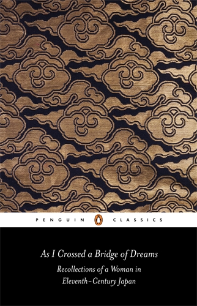

Source: [Watch the reel on Instagram](https://www.instagram.com/reel/DfZqjJRBEJV/) by Kitaab aur Dard (@kitaab.aurdard), posted 6 November 2026.

*Cover: Penguin Classics, translated by Ivan Morris.*

## Summary

Kitaab aur Dard recommends *As I Crossed a Bridge of Dreams* — the *Sarashina Diary*, written in Japan around 1060 by a woman we know only as the daughter of Sugawara no Takasue, because aristocratic women in Heian Japan were not named in the records.

The diary follows her across most of her life: it opens with her as a girl in a far province, desperate to reach the capital because she has heard there are books there, and closes with her old and alone, still thinking about them. A thousand years later, the diary survives and she does not — not even as a name.

What struck the creator most is how little has changed. She waits for books, begs relatives for them, reads at night when she should be doing something else, and feels guilty about how much she would rather be reading than praying. It is, in their words, their favourite Japanese book, and the oldest book they have read that felt like it was about them.

Their suggestion: if you want Japanese classics, or something short and very old to start with, start here.

> "A thousand years ago a woman wrote one of the most beautiful diaries in Japanese literature. We still don't know her name; only the book survived."

Watch the full reel at the link above — most of the detail is in its description.
