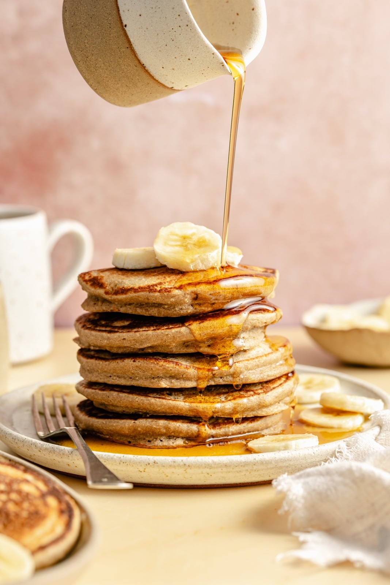

Source: [Healthy Banana Oatmeal Pancakes (made in the blender)](https://www.ambitiouskitchen.com/banana-oatmeal-pancakes/) by Monique Volz, Ambitious Kitchen. Originally published 29 April 2019, republished with new photos 19 June 2025.

*Photo: Ambitious Kitchen.*

## Summary

These are Monique Volz's most popular pancakes: fluffy, blender-made, and built on rolled oats instead of flour, with ripe bananas for sweetness — no flour, no butter, and no added sugar. Prep 10 minutes, cook 10 minutes, total 20 minutes. Makes 9 pancakes; serves 3, with 3 pancakes each (about 311 calories and 12g protein per serving). They freeze well, so they work as a make-ahead weekday breakfast.

## Ingredients

- 2 medium ripe bananas, best when they have lots of brown spots
- 2 eggs
- 1/2 cup (120g) unsweetened almond milk
- 1 teaspoon vanilla extract
- 1 1/2 cups (143g) old fashioned rolled oats, gluten free if desired
- 2 teaspoons baking powder
- 1/2 teaspoon ground cinnamon
- 1/4 teaspoon salt
- Olive oil, for cooking

## Procedure

1. Add all of the ingredients to a blender and blend on high until completely smooth, about 30 seconds to 1 minute. Let the batter sit in the blender while you heat your pan.
2. Lightly coat a griddle with coconut oil, vegan butter or olive oil and place over medium heat. Once the pan is hot, add 1/3 cup of batter to the griddle for each pancake and cook for 2–4 minutes, until the pancakes slightly puff up and you see a few bubbles along the edges.
3. Flip and cook until golden brown on the underside. If the pancakes are browning too quickly, lower the heat — start on medium, then drop to medium-low later so they don't burn. If the griddle starts smoking, the pan is too hot.
4. Wipe the skillet clean and repeat with more oil and the remaining batter.

Serve with fresh fruit and a drizzle of pure maple syrup if you like. For mix-ins, fold in chopped pecans, diced banana or chocolate chips after blending; for toppings, try pecans, banana slices, peanut butter, maple syrup or a dollop of yogurt.

To freeze: place the pancakes on a baking sheet so they aren't touching, freeze for 30 minutes, then move to freezer-safe containers and freeze for up to 3 months. Reheat on a plate in the microwave for 30–60 seconds, until warm.
