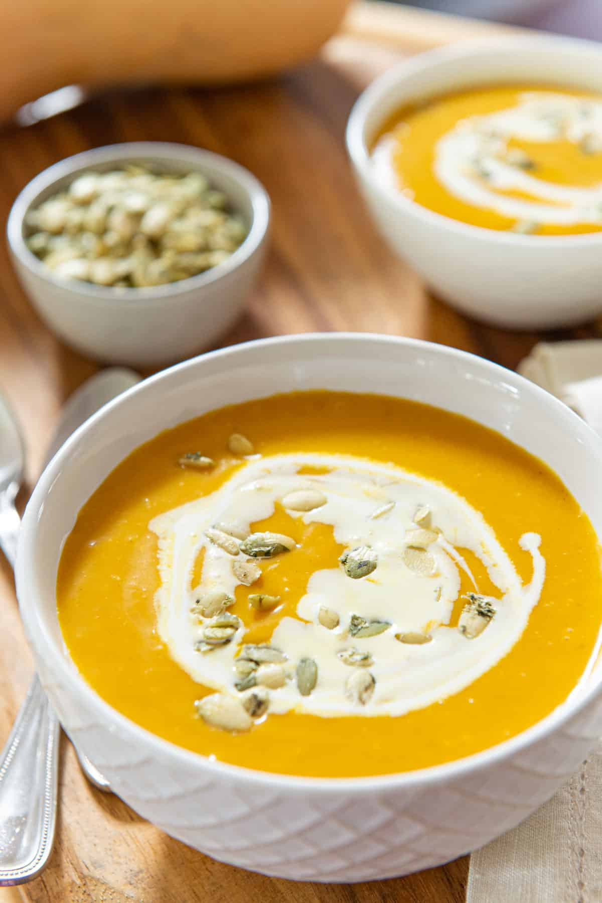
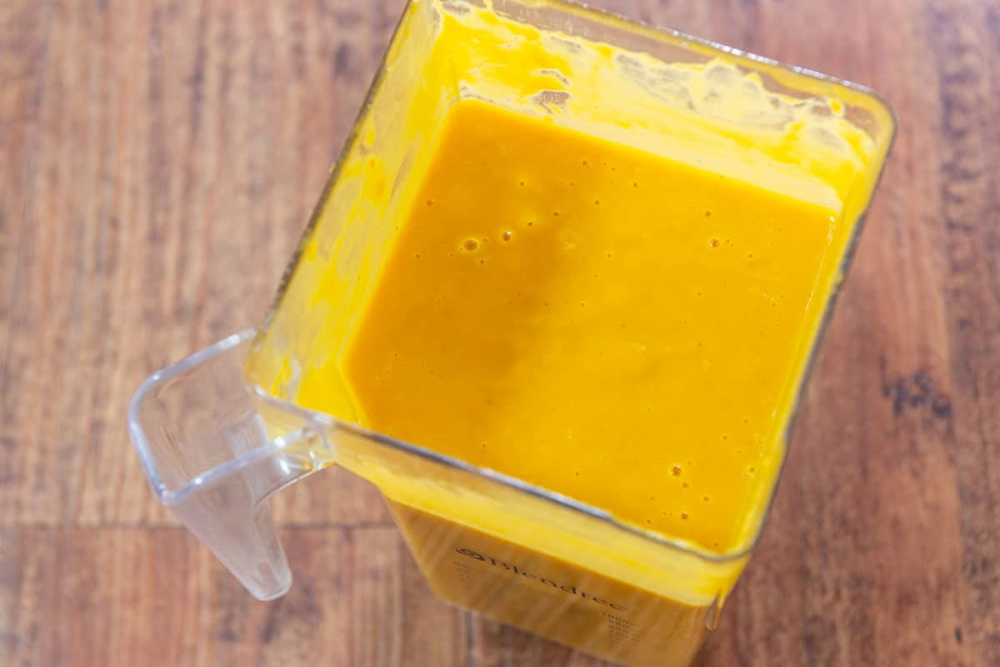

Source: [Easy Roasted Butternut Squash Soup](https://www.fifteenspatulas.com/butternut-squash-soup/) by Joanne, Fifteen Spatulas, originally published November 2015, updated January 2026.

*Photo: Fifteen Spatulas.*

## Summary

A roasted butternut squash soup that gets its flavour from roasting the squash in cubes first — that caramelises the natural sweetness — rather than from sugar or dairy. The soup itself is made without dairy, though it can be served with a cream drizzle and toasted pumpkin seeds. It serves about 6 people, about 7 cups, and takes about 55 minutes in total, including 30 minutes to roast the squash.

## Ingredients

- 3 lb roasted butternut squash, cubed
- 2 tbsp butter or olive oil
- 1 1/2 cups chopped yellow onion
- 1/4 tsp salt
- 1/8 tsp black pepper
- 1/8 tsp ground cinnamon
- 6 cups vegetable or chicken broth
- Heavy cream, for garnish (optional)
- Toasted pumpkin seeds, for garnish (optional)

## Procedure

1. Roast the butternut squash in cubes first, about 30 minutes. This can be done up to 3 days ahead, and the roasted squash keeps in the fridge in an airtight container.
2. Melt the butter or oil in a large pot over medium heat. Add the onion, salt and pepper and cook for about 10 minutes, until the onion is soft.
3. Add the roasted squash cubes and the cinnamon, and stir for a couple of minutes, until the cinnamon is fragrant.
4. Add the broth, bring to a boil, then simmer for 2 minutes — the vegetables are already cooked, so this is mainly to heat the liquid through.
5. Puree until smooth, with an immersion blender in the pot, or by cooling the soup slightly and blending it in batches in a regular blender.

*Photo: Fifteen Spatulas.*

6. Taste and adjust the salt and pepper. If you like a thicker soup, start with 4 cups of broth instead of 6, puree, then add more to taste.
7. Serve as is, or with a drizzle of heavy cream and a few pumpkin seeds.

Leftovers keep in the fridge for up to 7 days in an airtight container, and freeze for up to 2 months.
