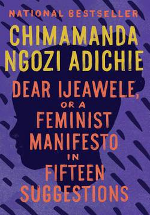

Source: [Watch the reel on Instagram](https://www.instagram.com/reel/De4OwXgT3-o/) by Himanshu Bhalla (@bestbhallaintown), posted 24 October 2026.

*Cover: Vintage / Penguin Random House, 2018.*

## Summary

Bhalla recommends *Dear Ijeawele, or A Feminist Manifesto in Fifteen Suggestions* by Chimamanda Ngozi Adichie — a short book, written as a letter to a friend who asked how to raise her baby daughter as a feminist, with fifteen suggestions. His on-screen text is "DON'T BE LIKEABLE."

His main point is the book's advice to teach a daughter to reject likability: her job is not to make herself likable, but to be her full, honest self. He argues that society teaches girls to be nice and agreeable in a way it does not teach boys, and that this conditioning is dangerous — it can leave girls silent about harm, and wasting time being nice to people who harm them.

He holds up the thin book — about 80 pages — and says it can be read in two to three days, even by non-readers.

> "Teach her to reject likability."

Watch the full reel at the link above for his full recommendation.
