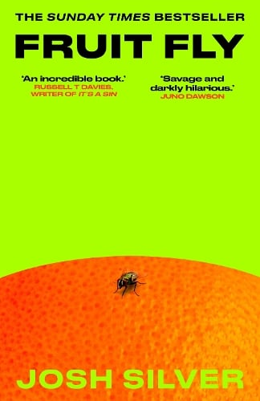

Source: [Watch the reel on Instagram](https://www.instagram.com/reel/DfTaI1PvtOv/) by Soozi (@soozithemoodreader), posted 3 November 2026.

*Cover: Oneworld Publications, 2026.*

## Summary

Soozi gives *Fruit Fly* by Josh Silver five stars and calls it phenomenal — a book she could not put down.

It follows Mallory Maddox, an author who shot to fame seven years ago and has been blocked ever since. Desperate to revive her career, she downloads Grindr and pretends to be her husband. That is how she meets Leo, at what turns out not to be a tea party at all — a vulnerable young man, a struggling addict, who becomes the material for the book she needs to write.

Soozi went in expecting it to be, in her words, so gay and so funny — and it starts that way. Halfway through it turns really dark and really scary, and she disliked some of the characters. By the end, though, she calls it so brilliant, saying it took her all around the world in terms of emotions, and probably one of the top five best books of the year — even if it is not your usual genre.

> "Go gay. Go sad. Go dark."

Watch the full reel at the link above for her full recommendation.
