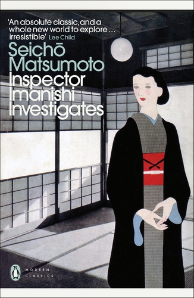

Source: [Watch the reel on Instagram](https://www.instagram.com/reel/DfreItRhVo2/) by Book Peeker (@bookpeeker), posted 13 November 2026.

*Cover: Penguin Modern Classics, 2025.*

## Summary

Book Peeker recommends *Inspector Imanishi Investigates* by Seicho Matsumoto as an off-the-beaten-path pick for anyone into Japanese crime novels, which he notes have become all the rage recently.

It is an atmospheric detective mystery set in Japan in the 1960s, when investigations were far more manual than today: things happen over letters, over the course of days, and detectives travel by train to gather evidence and interview suspects. The reel paints a nostalgic world — rural poverty, the lingering impact of the war, uncomfortable train journeys between Tokyo and the countryside — and a Japan clearly quite different from the Japan of today. The focus is on atmosphere and character, not just the puzzle.

Matsumoto was self-educated, began writing at forty, and produced over 450 works; six were initially translated into English. This novel sold over 4.5 million copies in Japan and became a blockbuster film. Book Peeker recommends it strongly for fans of classic whodunits, and also mentions Matsumoto's *Tokyo Express*.

Watch the full reel at the link above for his full recommendation.
