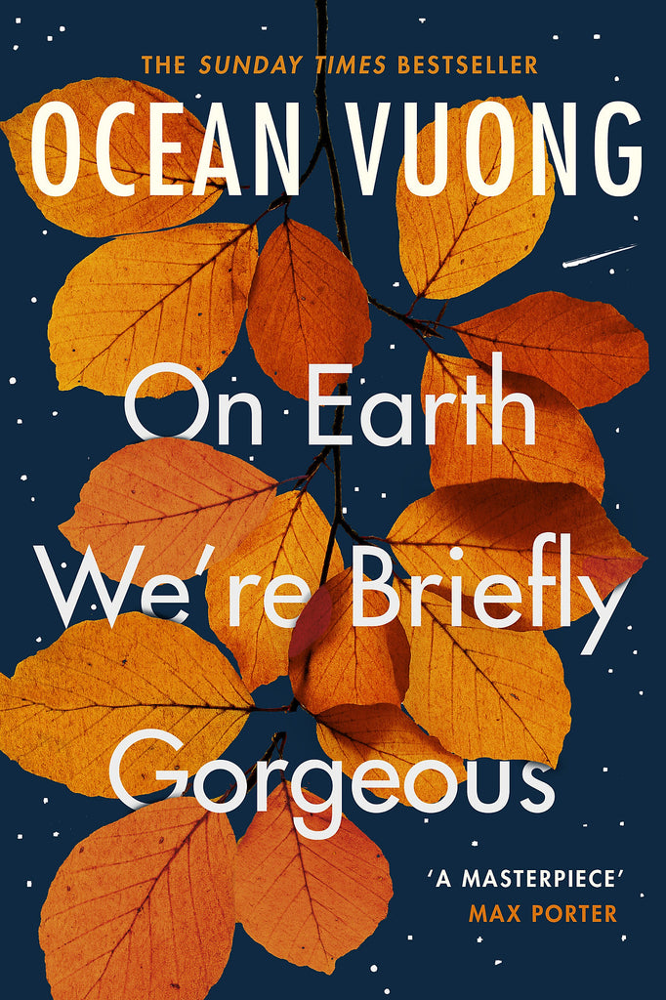

Source: [Watch the reel on Instagram](https://www.instagram.com/reel/DfnB8sstX8R/) by Aayushi Soni (@aviothic.a), posted 11 November 2026.

*Cover: Vintage / Penguin, 2020.*

## Summary

Aayushi Soni recommends *On Earth We're Briefly Gorgeous*, Ocean Vuong's debut novel, in under fifty seconds — and calls it her pick.

The book is written as a letter from a son to his mother, who cannot read. Through that letter, Vuong explores family, violence, identity, and growing up trying to make sense of where you come from. Its central idea, as she puts it, is the complicated way we inherit love: the people who sacrifice the most for us are often those who have sacrificed the most themselves — and their pain does not erase our own.

She describes it as a book that makes you stop mid-sentence to reflect on what you have just read, and invites viewers to say which line stayed with them.

> "Some books feel less like reading and more like someone has finally found the words for something you've never been able to explain."

Watch the full reel at the link above for her full recommendation.
